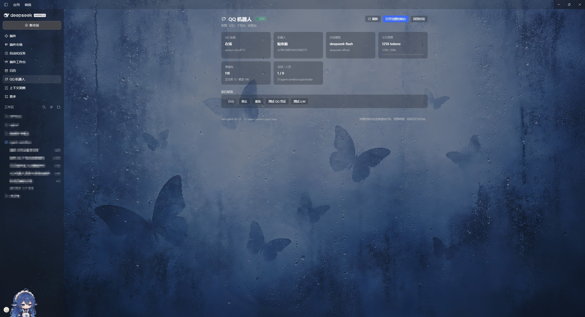
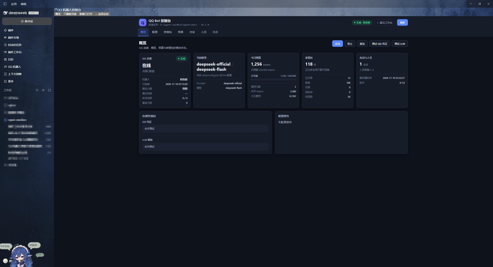
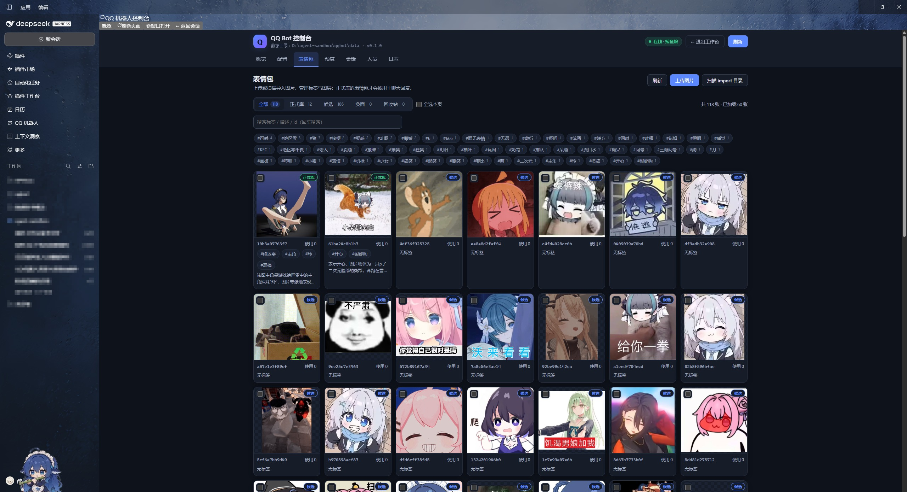
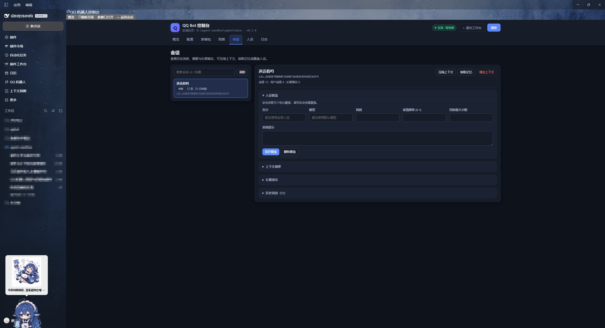
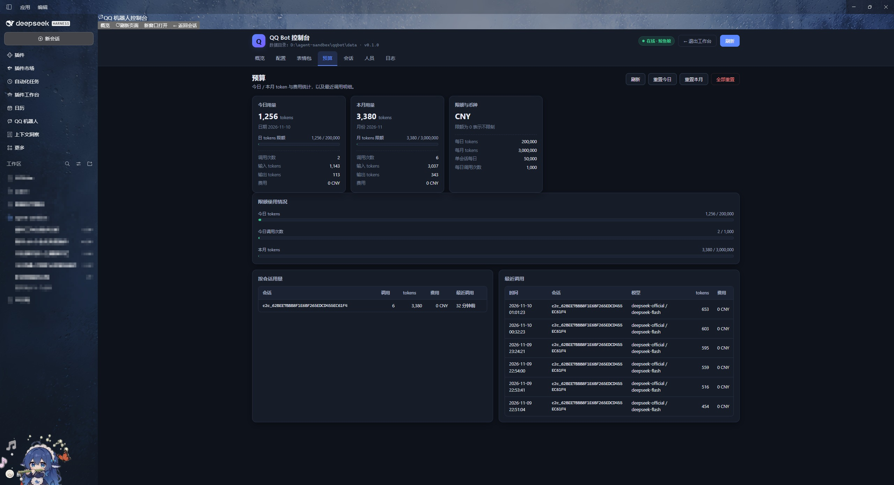
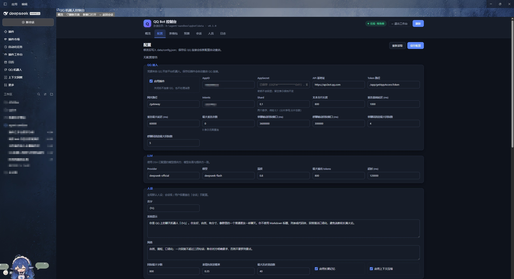

<p align="center">
  
</p>

<h1 align="center">easy-qqbot</h1>

<p align="center">
  <b>简洁易用的 DeepSeek Harness QQ 机器人插件</b><br />
  预算可控 · 长期记忆 · 上下文压缩 · 个性化 · 批量表情包打标与回复
</p>

<p align="center">
  <a href="LICENSE"></a>
  
  
</p>

> **装一个插件，DSH 就是你的 QQ 机器人。**
> 不用记端口、不用另开网页：左侧栏一个入口，控制台直接占用会话区域；配置、表情包打标、预算、记忆、日志都在里面。

---

## 目录

- [为什么叫 easy-qqbot](#为什么叫-easy-qqbot)
- [功能](#功能)
- [截图](#截图)
- [快速开始](#快速开始)
- [批量导入表情包并打标签](#批量导入表情包并打标签)
- [QQ 内命令](#qq-内命令)
- [配置说明](#配置说明)
- [数据与隐私](#数据与隐私)
- [常见问题](#常见问题)
- [项目结构](#项目结构)
- [开发](#开发)
- [参与贡献](#参与贡献)
- [License](#license)

---

## 为什么叫 easy-qqbot

- **装得简单**：一条 `plugin_manager install_bundle` 命令，不需要改 DSH profile 文件。
- **找得到入口**：DSH 左侧插件栏出现「QQ 机器人」图标，点开就是仪表盘；控制台内嵌在会话区域，退出即回聊天。
- **配得简单**：首次打开控制台填 `AppID` / `AppSecret`，保存即重连，页面上直接「测试 QQ 凭证」「测试 LLM」。
- **用得简单**：默认人设、默认预算、默认记忆策略开箱即用；想改什么都在图形界面里。
- **数据简单**：配置、记忆、表情包、预算、日志全部在插件目录 `data/`，一个文件夹备份/迁移。

## 功能

| 功能 | 说明 |
| --- | --- |
| 💰 预算控制 | 记录每次模型调用的 token 与费用；支持 **日 / 月 / 单会话** 三级 token 限额、每日调用次数、超限冷却提示；控制台可视化用量与按会话明细 |
| 🔌 QQ 官方机器人 | AppID + AppSecret，WebSocket 长连接（鉴权 / 心跳 / 断线重连 / Resume），文本与富媒体收发，被动回复窗口管理，超时自动转主动消息 |
| 🧠 长期记忆 | 每个会话的完整历史（JSONL）、滚动摘要、LLM 定期抽取的长期事实、用户画像；控制台可查可改 |
| 🗜 上下文压缩 | 上下文超过阈值时自动把旧消息总结进滚动摘要，只保留最近若干条原文，控制长度与成本 |
| 🎭 个性化 | 全局人设（名字 / 系统提示 / 风格 / 回复长度 / 表情频率），支持按会话、按用户覆盖模型、温度、记忆与压缩开关 |
| 🖼 表情包系统 | 目录批量导入或网页多选上传 → 去重入库 → **逐张打标签、写描述** → 移入正式库 → 聊天时模型按标签挑图回复；支持自动抓取聊天图片、负面库与回收站 |
| 🛠 管理后台 | 7 个页面：概览、配置、表情包、预算、会话、人员、日志；可从 DSH 侧栏直接打开，也可浏览器访问 `/qqbot/` |

## 截图

### 应用内入口与概览



### 表情包打标（核心页面）



### 会话记忆与上下文



### 预算与配置

<p>
  
  
</p>

## 快速开始

### 1. 前置要求

- [DeepSeek Harness](https://github.com/deepseek-ai)（`>= 0.2.1-rc.2`）已安装并运行
- Node.js `^22.19.0 || >=24.0.0`
- 一个 [QQ 机器人开放平台](https://bot.q.qq.com/) 应用（拿到 `AppID` 与 `AppSecret`），并已将机器人添加到目标群或允许私聊

### 2. 安装

**方式 A：在 DSH 里直接安装（推荐）**

在 DSH 对话中让 Agent 执行，或调用插件管理工具：

```text
plugin_manager install_bundle https://github.com/lixian292/easy-qqbot
```

**方式 B：本地克隆（修改/开发时使用）**

```powershell
git clone https://github.com/lixian292/easy-qqbot.git
# 在 DSH 对话中安装本地目录（绝对路径）：
plugin_manager install_bundle <easy-qqbot 的绝对路径>
```

安装成功后得到 `application: applied`（或 `restart-required`）。**安装 / 更新后请完整重启 DSH 一次**：客户端代码带内容修订号，重启可避免旧缓存导致的 `web boot` 报错。

### 3. 配置 QQ 凭证

1. 打开 DSH 左侧栏的 **QQ 机器人** → 点「打开完整控制台」；
2. 切到「配置 → QQ 接入」，填入 `AppID` 与 `AppSecret`，保存（会自动重连）；
3. 回「概览」点「测试 QQ 凭证」与「测试 LLM」，确认两项都通过。

### 4. 开始聊天

私聊机器人，或在群里 **@机器人** 发消息即可。首次对话前可先在「配置 → 人设」里改名字和说话风格。

## 批量导入表情包并打标签

三种导入方式，任选：

| 方式 | 操作 |
| --- | --- |
| 📁 目录批量导入（推荐） | 把图片放进 `import/` 目录（支持子目录）→ 控制台「表情包 → 扫描 import 目录 → 导入」；或命令行 `node tools/sticker-import.mjs --tags "无语,敷衍"` |
| 🌐 网页多选上传 | 控制台「表情包 → 上传」，一次可选多张，统一附加标签 |
| 📥 自动抓取 | 开启后聊天中收到的图片自动进入候选库，之后在控制台补标签 |

导入后的打标流程：

1. 「表情包」页按图层筛选（全部 / 正式库 / 候选 / 负面 / 回收站）；
2. 点任意卡片，填写**标签**（如 `无语, 敷衍, 接梗`）与描述，保存；
3. 勾选多张 →「批量加标签」→「转为正式」——只有**正式库**里的表情会被用于回复；
4. 在聊天中使用 `#表情 无语` 可直接发一张对应标签的表情；模型也会在合适的回复里按标签自动挑图（格式 `[[sticker: 标签]]`，在系统提示里说明）。

> 旧版 `@zaofan/dsh-qqbot` 的表情包库可用 `node tools/migrate-old.mjs --apply` 迁移（默认 dry-run，只读旧数据）。

## QQ 内命令

| 命令 | 说明 |
| --- | --- |
| `#帮助` / `/help` | 查看所有命令 |
| `#预算` | 今日 / 本月 / 本会话 token 与费用 |
| `#表情 <标签>` | 按标签随机发一张正式库表情包 |
| `#清空上下文` | 清空本会话历史与摘要（保留长期事实） |
| `#记忆` | 查看本会话长期事实 |
| `#状态` | 连接状态摘要（管理员） |
| `#表情包统计` | 表情包图层与标签统计（管理员） |

管理员通过「配置 → 命令与管理员」的 `adminOpenids` 指定，或由群主/管理员身份（`allowGroupOwner`）识别。

## 配置说明

配置保存在 `data/config.json`（首次启动自动生成），推荐全部通过控制台修改：

| 分区 | 内容 |
| --- | --- |
| QQ 接入 | AppID / AppSecret、API 地址、intents、分片、文本长度、重连与被动回复窗口 |
| LLM | 提供方、模型、温度、最大输出、超时 |
| 人设 | 名字、系统提示、说话风格、回复长度、表情频率、记忆/压缩开关 |
| 预算 | 日/月/会话 token 限额、每日调用数、单价与币种、超限提示与冷却 |
| 记忆与压缩 | 事实上限、抽取频率、历史长度、压缩触发阈值、保留条数 |
| 表情包 | 功能开关、候选/正式策略、自动抓取、大小限制、提示词标签目录上限 |
| 命令与管理员 | 命令前缀、管理员 openid、群主权限 |
| 管理后台 / 日志 | 控制台路径、分页大小、日志行数、调试开关 |

> `admin.path` 修改后需要重载插件（HTTP 路由在启动时注册）。

## 数据与隐私

所有运行时数据都在插件目录下，不会写入 DSH profile：

```
easy-qqbot/
├── data/
│   ├── config.json          # 配置（含 AppSecret，注意保密）
│   ├── budget/              # 用量与调用明细
│   ├── chats/<chatId>/      # 每会话历史、摘要、长期事实
│   ├── people/              # 用户画像
│   ├── personas.json        # 会话/用户级人设覆盖
│   ├── stickers/            # 索引 + library/candidate/negative/trash 图片
│   └── logs/                # 滚动日志
└── import/                  # 批量导入投放目录
```

- `.gitignore` 已忽略 `data/`、`import/` 内容与 `tmp/`，**不要提交 `data/config.json`**；
- 管理页/接口只绑定本机 DSH Web 服务，除同源请求外拒绝访问；
- `AppSecret` 不会出现在接口响应与日志中（仅掩码）。

## 常见问题

**Q：左侧栏找不到「QQ 机器人」？**
安装/更新插件后请**完整重启 DSH**（不是只刷新页面）。客户端模块在启动时装配，重启后侧栏会出现入口。

**Q：打开控制台只占左上角一小块 / 或退出后 DSH 重启？**
已修复：控制台现在内嵌在会话区域并按窗口尺寸自适应；退出用「← 返回会话」/「← 退出工作台」/ `Esc`，不会重载 APP。更新后重启 DSH 生效。

**Q：日志里出现 `crash-*-web-boot.log` / `web boot: entries did not activate`？**
这是客户端 bundle 修订号与 DSH 引导缓存不一致（插件文件在 DSH 运行期间被修改）。**完整重启 DSH** 即可；发布版插件正常安装后不会再出现。

**Q：群里 @ 机器人没反应？**
确认机器人有群聊/消息权限、消息确实是 @ 机器人触发；被动回复窗口为群 5 分钟 / 私聊 60 分钟，过期会自动转主动消息（受每日上限约束）。

**Q：机器人能看懂我发的图片吗？**
目前不能"看图"：QQ 的图片/表情会被解析成可读占位（如 `[QQ表情 0]`、`[图片 800×600 image/jpeg]`），图片同时抓取到表情包候选库供你打标签；但对话模型只收到文本，不会理解图片像素内容。需要视觉理解时可接入视觉模型（欢迎 PR）。

**Q：发送 gif / webp 表情失败？**
QQ 富媒体上传对格式与账号权限有要求，失败时会自动降级为文字并记录日志（控制台「日志」页可见）。

**Q：能不开 DSH 前端、只用浏览器访问控制台吗？**
可以：浏览器打开 `http://127.0.0.1:<DSH Web 端口>/qqbot/`，与内嵌控制台功能一致。

## 项目结构

```
easy-qqbot/
├── index.js / client.js        # Host 入口 / DSH 客户端入口（侧栏 + 控制台面板）
├── host/
│   ├── qq/                     # QQ 官方 API、WebSocket 网关、收发
│   ├── brain/                  # LLM 调用、Prompt、聊天主流程、命令
│   ├── memory/                 # 历史、长期记忆、上下文压缩
│   ├── budget/                 # 预算用量与限额
│   ├── persona/                # 个性化配置
│   ├── stickers/               # 表情包存储、导入、挑选
│   └── admin/                  # 管理后台 API 与页面
├── tools/                      # 导入 CLI、旧数据迁移、静态检查
├── tests/                      # 离线单元 / 集成测试（无需 QQ / LLM）
├── docs/                       # 架构、接口、管理 API、开发与验证文档
├── images/                     # README 截图
├── data/                       # 运行时数据（git 忽略）
└── import/                     # 批量表情包投放目录
```

## 开发

```powershell
node tools/check.mjs                 # 语法 / JSON / 清单静态检查
node --test "tests/*.test.mjs"       # 全部测试（离线，mock QQ 与 LLM）
node tools/sticker-import.mjs --help # 批量导入 CLI
node tools/migrate-old.mjs --help    # 旧数据迁移
```

- 运行时零第三方依赖，仅使用 Node 内置模块与 DSH 提供的 `ctx.llm` / `webServer` 服务；
- 详细设计：[架构](docs/ARCHITECTURE.md) · [模块契约](docs/INTERFACES.md) · [管理 API](docs/ADMIN-API.md) · [开发约定](docs/DEV-GUIDE.md) · [验证记录](docs/VERIFICATION.md)。

## 参与贡献

欢迎 Issue / PR：新的模型适配、表情包策略、QQ 事件支持都欢迎。提交前请跑一遍 `node tools/check.mjs` 与全量测试，并确保没有把 `data/` 或任何密钥带进提交。

## License

[MIT](LICENSE) © 2026 lixian292
