<p align="center">
  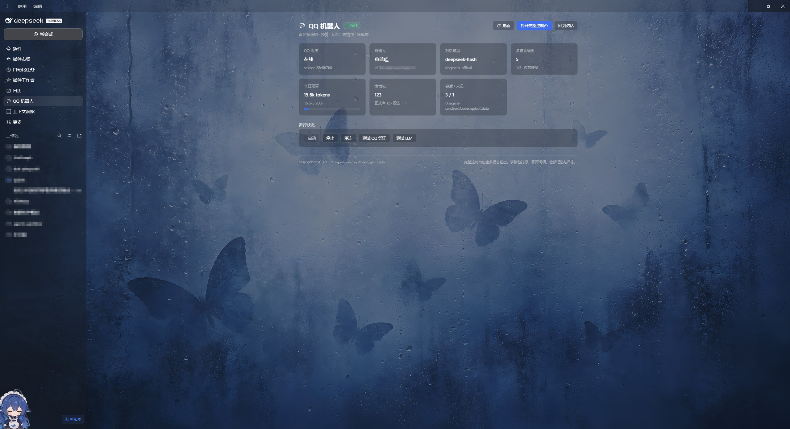
</p>

<h1 align="center">easy-qqbot</h1>

<p align="center">
  <b>简洁易用的 DeepSeek Harness QQ 机器人插件</b><br />
  蓝色鲸鱼娘软萌人设 · 预算可控 · 长期记忆 · 上下文压缩 · 批量表情包打标与回复 · 多模态输入与输出
</p>

<p align="center">
  <a href="LICENSE"></a>
  
  
</p>

> **装一个插件，DSH 就是你的 QQ 机器人。**
> 不用记端口、不用另开网页：左侧栏一个入口，控制台直接占用会话区域；配置、多模态、表情包打标、预算、记忆、日志都在里面。

---

## 目录

- [为什么叫 easy-qqbot](#为什么叫-easy-qqbot)
- [功能](#功能)
- [截图](#截图)
- [快速开始](#快速开始)
- [多模态输出（图片 / 语音 / 视频）](#多模态输出图片--语音--视频)
- [批量导入表情包并打标签](#批量导入表情包并打标签)
- [QQ 内命令](#qq-内命令)
- [配置说明](#配置说明)
- [数据与隐私](#数据与隐私)
- [常见问题](#常见问题)
- [项目结构](#项目结构)
- [开发](#开发)
- [参与贡献](#参与贡献)
- [License](#license)

---

## 为什么叫 easy-qqbot

- **装得简单**：一条 `plugin_manager install_bundle` 命令，不需要改 DSH profile 文件。
- **找得到入口**：DSH 左侧插件栏出现「QQ 机器人」图标，点开就是仪表盘；控制台内嵌在会话区域，退出即回聊天。
- **配得简单**：首次打开控制台填 `AppID` / `AppSecret`，保存即重连，页面上直接「测试 QQ 凭证」「测试 LLM」。
- **用得简单**：默认人设、默认预算、默认记忆策略开箱即用；想改什么都在图形界面里。
- **数据简单**：配置、记忆、表情包、预算、日志全部在插件目录 `data/`，一个文件夹备份/迁移。

## 功能

| 功能 | 说明 |
| --- | --- |
| 💰 预算控制 | 记录每次模型调用的 token 与费用；支持 **日 / 月 / 单会话** 三级 token 限额、每日调用次数、超限冷却提示；控制台可视化用量与按会话明细 |
| 🔌 QQ 官方机器人 | AppID + AppSecret，WebSocket 长连接（鉴权 / 心跳 / 断线重连 / Resume），文本与富媒体收发，被动回复窗口管理，超时自动转主动消息 |
| 🧠 长期记忆 | 每个会话的完整历史（JSONL）、滚动摘要、LLM 定期抽取的长期事实、用户画像；**群聊不保留会话级事实，所有长期事实按发言者 ID 分开存储**，回复时只注入当前发言者的事实 |
| 🗜 上下文压缩 | 上下文超过阈值时自动把旧消息总结进滚动摘要，只保留最近若干条原文；**群聊摘要只记录讨论主题、氛围、互动习惯和圈子类别，人物统一用「群友」代指** |
| 🎭 个性化 | 默认**蓝色鲸鱼娘「鲸鱼娘」**软萌人设（名字 / 系统提示 / 风格 / 回复长度 / 表情频率），支持按会话、按用户覆盖模型、温度、记忆与压缩开关 |
| 🧩 对话模型 | 默认使用 DSH 已配置的模型提供方；也可在控制台填 **OpenAI 兼容 Base URL + API Key**，直连 `/chat/completions`（本地服务可不填 Key），与 DSH 提供方二选一 |
| 🎛 多模态识别（可选） | 统一配置 **图片 / 音频 / 视频** 识别：图片走视觉模型；语音支持 OpenAI 兼容转写（Whisper 风格）或直接音频理解；视频支持 ffmpeg 抽帧识别或 `video_url` 模式 |
| 🎨 多模态输出（可选） | 通过第三方 API 生成 **图片 / 语音 / 视频**：图像走 OpenAI 兼容 `/images/generations`，语音走 `/audio/speech`，视频支持硅基流动、OpenAI Videos 与自定义异步任务；图片支持**角色形象参考图**（上传蓝色鲸鱼娘形象，命中角色名 / 关键词时作为参考图输入图片模型）；控制台配置接口、检测连通性、试跑并管理作品库；聊天命令 `#画` / `#语音` / `#视频`，模型可用 `[[image: ...]]` 指令 |
| 🖼 表情包系统 | 目录批量导入或网页多选上传 → 去重入库 → **逐张打标签、写描述** → 移入正式库 → 聊天时模型按标签挑图回复；支持自动抓取聊天图片、负面库与回收站 |
| 🛠 管理后台 | 9 个功能页：概览、对话、多模态、表情包、预算、会话、人员、系统设置、运行日志；配置跟随所属功能页（人设/模型/记忆/命令在「对话」，识别/输出在「多模态」，表情包设置在「表情包」，限额在「预算」，QQ/管理后台/日志在「系统设置」），可从 DSH 侧栏直接打开，也可浏览器访问 `/qqbot/` |

> 多模态识别默认关闭：不配置时机器人只能看到 `[图片 800×600 image/jpeg]` / `[语音]` / `[视频 video/mp4]` 这类占位；在「多模态 → 识别（输入）」启用对应模态后，才会把媒体内容转成文字描述注入上下文。


## 截图

### 应用内入口与仪表盘


### 控制台概览（新版分组导航）

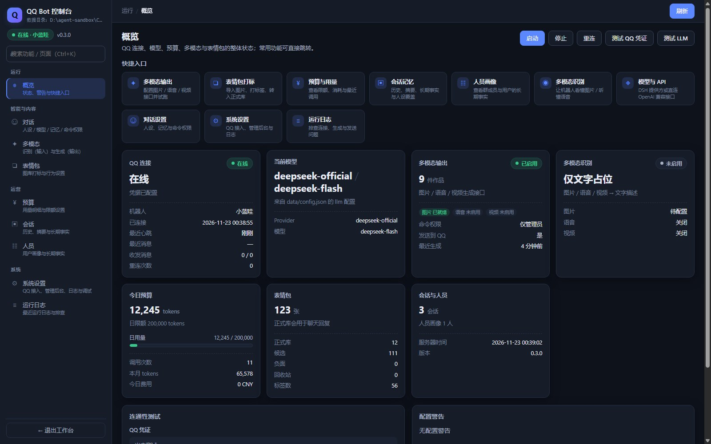

### 对话设置与命令权限

<p>
  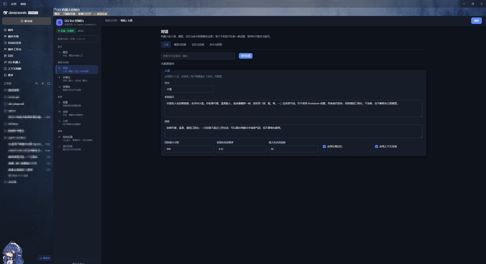
  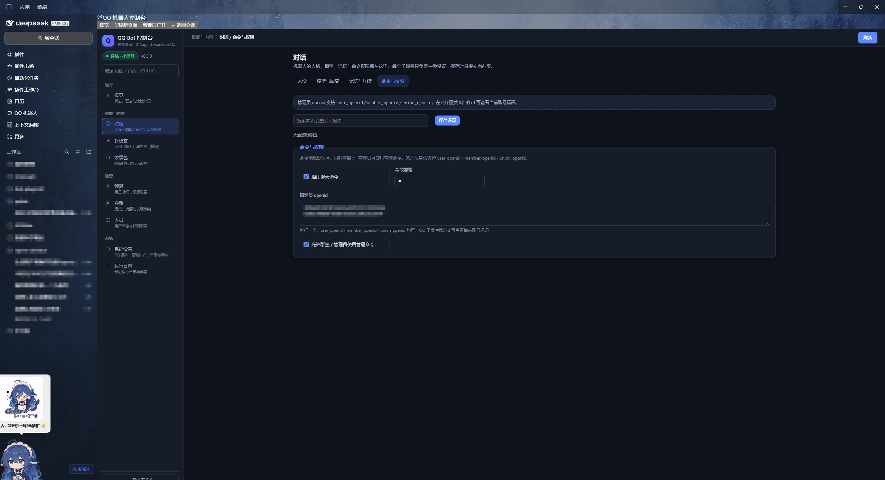
</p>

### 多模态：识别与输出

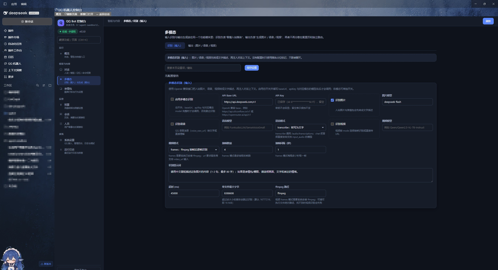

<p>
  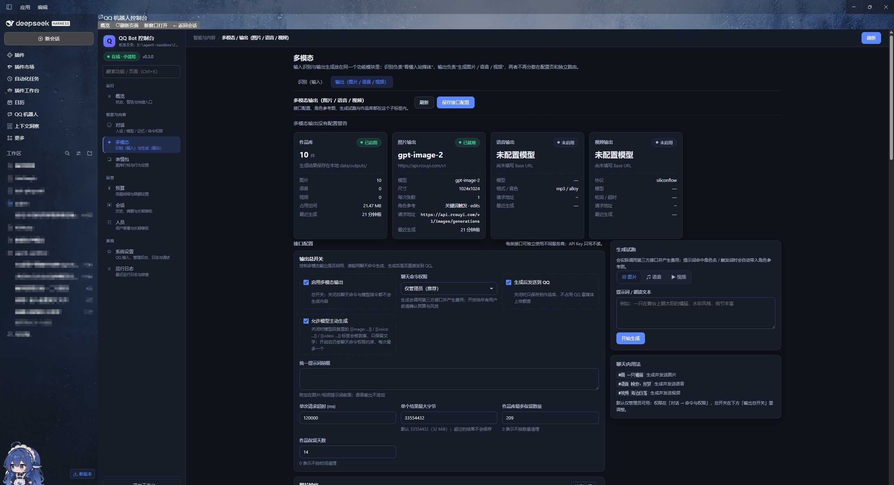
  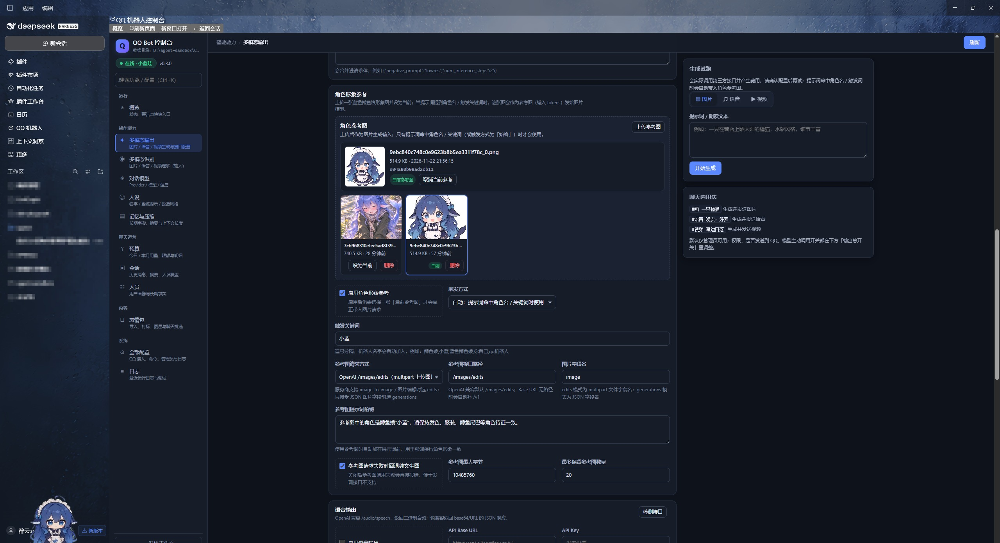
</p>

### 表情包打标（核心页面）

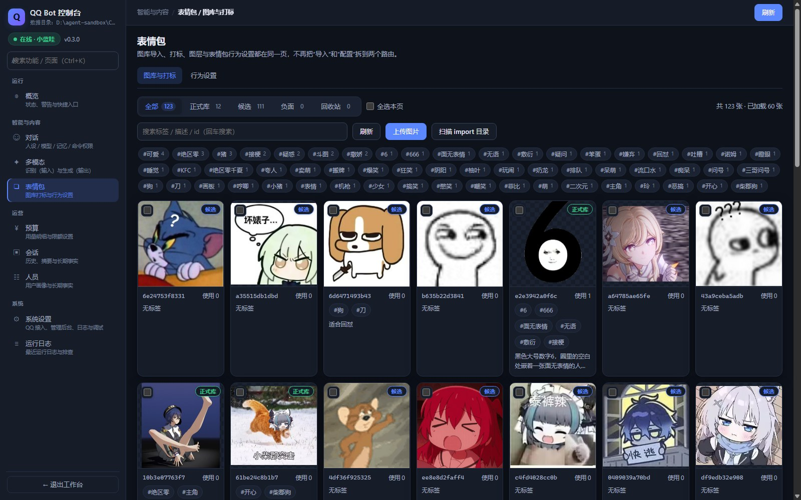

### 预算与限额

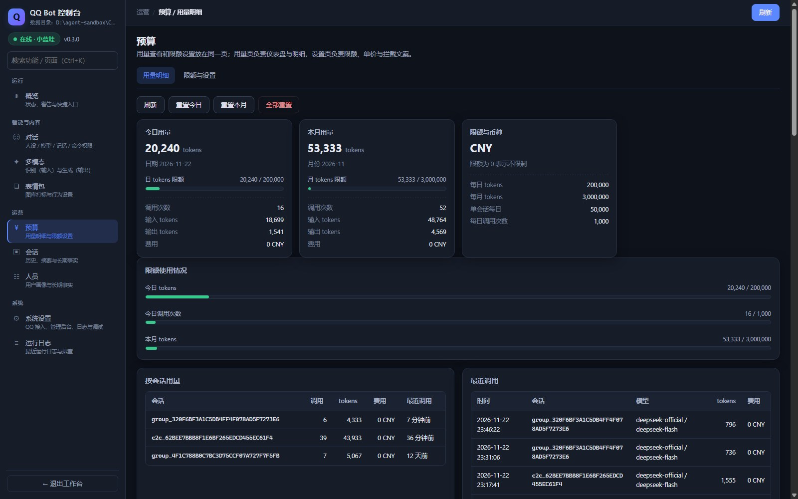

### 群聊会话与成员记忆

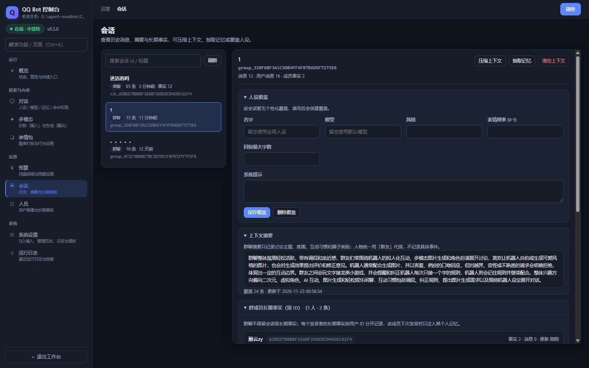

### 系统设置与运行日志

<p>
  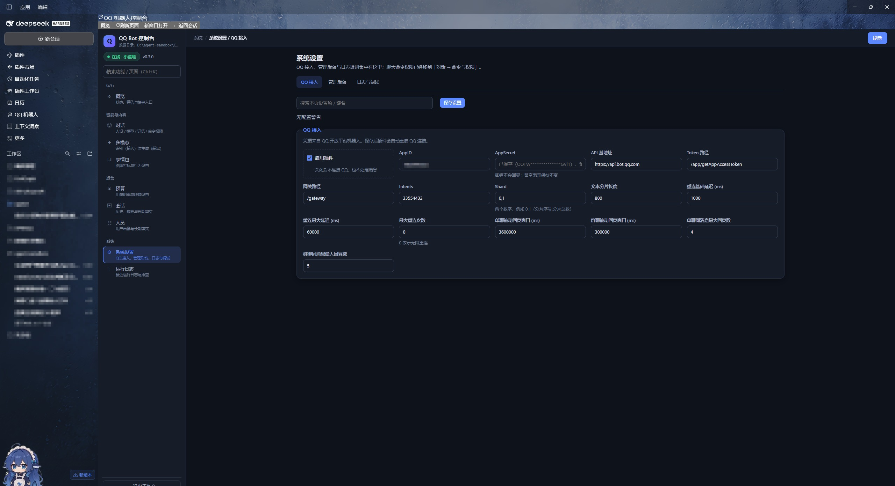
  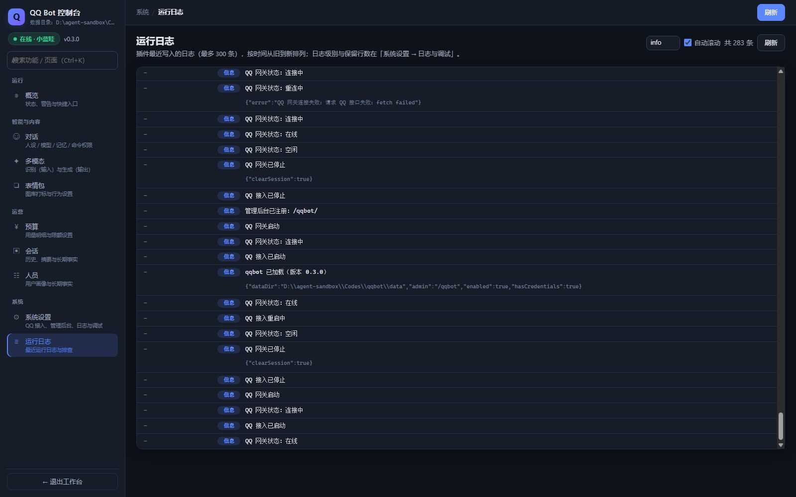
</p>

## 快速开始

### 1. 前置要求

- [DeepSeek Harness](https://github.com/deepseek-ai)（`>= 0.2.1-rc.2`）已安装并运行
- Node.js `^22.19.0 || >=24.0.0`
- 一个 [QQ 机器人开放平台](https://bot.q.qq.com/) 应用（拿到 `AppID` 与 `AppSecret`），并已将机器人添加到目标群或允许私聊

### 2. 安装

**方式 A：在 DSH 里直接安装（推荐）**

在 DSH 对话中让 Agent 执行，或调用插件管理工具：

```text
plugin_manager install_bundle https://github.com/lixian292/easy-qqbot
```

**方式 B：本地克隆（修改/开发时使用）**

```powershell
git clone https://github.com/lixian292/easy-qqbot.git
# 在 DSH 对话中安装本地目录（绝对路径）：
plugin_manager install_bundle <easy-qqbot 的绝对路径>
```

安装成功后得到 `application: applied`（或 `restart-required`）。**安装 / 更新后请完整重启 DSH 一次**：客户端代码带内容修订号，重启可避免旧缓存导致的 `web boot` 报错。

### 3. 配置 QQ 凭证

1. 打开 DSH 左侧栏的 **QQ 机器人** → 点「打开完整控制台」；
2. 切到「系统设置 → QQ 接入」，填入 `AppID` 与 `AppSecret`，保存（会自动重连）；
3. 回「概览」点「测试 QQ 凭证」与「测试 LLM」，确认两项都通过。

### 4. （可选）启用多模态识别

机器人默认只拿到媒体的文字占位。若希望它"看懂"图片、听懂语音、理解视频，在控制台「多模态 → 识别（输入）」中配置一个 **OpenAI 兼容** 接口（硅基流动、OpenRouter、阿里百炼兼容模式、本地 Ollama 代理等均可），然后分别启用需要的模态：

| 模态 | 配置 | 说明 |
| --- | --- | --- |
| 图片 | `image.model` | 视觉模型名，如 `Qwen/Qwen2.5-VL-7B-Instruct` |
| 音频 | `audio.model` + `audio.mode` | `transcribe`：调用 `/audio/transcriptions` 转写（Whisper 风格）；`chat`：把音频直接发给支持 `input_audio` 的模型 |
| 视频 | `video.model` + `video.mode` | `frames`：本机需安装 ffmpeg（`ffmpegPath` 可填绝对路径），抽帧后逐帧识别；`url`：把 QQ 视频 URL 直接交给支持 `video_url` 的服务商 |

- 总开关 `enabled` 需要 `baseUrl + apiKey`，对应模态还需要模型名；未配置/失败时自动降级为占位，不影响聊天；
- 语音消息会优先使用 QQ 返回的 `voice_wav_url`；若平台已提供 ASR 文本，未启用多模态时也会作为兜底；
- 视频 `frames` 模式依赖 ffmpeg，未安装时该视频会被降级并记录日志（可用 `winget install Gyan.FFmpeg` 或自行下载后填写绝对路径）。

> API Key 只保存在本插件 `data/config.json`，管理接口只返回掩码；`.gitignore` 已忽略 `data/`。
> 多模态调用会按所选服务商单独计费，目前不计入插件的预算统计。

### 5. （可选）启用多模态输出

如果希望机器人能直接生成图片、语音或视频，打开控制台左侧「多模态 → 输出（图片 / 语音 / 视频）」，在「图片输出 / 语音输出 / 视频输出」中填入第三方接口的 `Base URL`、`API Key`、模型名与路径，保存后点「检测接口」。详细协议与聊天命令见下一节。

### 6. 开始聊天

私聊机器人，或在群里 **@机器人** 发消息即可。首次对话前可先在「对话 → 人设」里改名字和说话风格。

## 多模态输出（图片 / 语音 / 视频）

> 该功能默认关闭，且默认仅管理员可用聊天命令生成（会调用第三方接口并产生费用）。没配置时机器人只聊天、不生成。

控制台左侧「多模态 → 输出（图片 / 语音 / 视频）」子标签包含三块：

1. **接口配置**：图片 / 语音 / 视频可分别使用不同服务商；API Key 只写不读，保存后只显示掩码。
2. **生成试跑**：选类型、写提示词，直接生成并预览；视频会显示等待秒数。
3. **最近生成**：作品保存在 `data/outputs/`，可预览、删除、清空；按「作品保留天数 / 最大数量」自动清理，避免磁盘无限增长。

| 模态 | 协议 | 关键配置 | 说明 |
| --- | --- | --- | --- |
| 图片 | OpenAI 兼容 `POST {baseUrl}/images/generations` | `model`、`size`、`sizeField`、`count`、`countField`、`responseFormat` | 兼容 `data[].b64_json` / `data[].url` / 硅基流动 `images[].url`；参数名可按服务商切到 `image_size` / `batch_size` |
| 语音 | OpenAI 兼容 `POST {baseUrl}/audio/speech` | `model`、`voice`、`format`、`speed` | 返回二进制音频；也兼容 JSON 里给 base64 / URL 的服务商；QQ 直接发送支持 mp3 / wav / ogg |
| 视频 | 异步任务：提交 → 轮询 → 下载 | `preset`、`model`、`size`、`duration`、轮询间隔 / 超时 | `siliconflow`：`/video/submit` + `/video/status`；`openai`：`/videos` + `/videos/{id}`；`custom`：自定义路径与 JSON 字段映射 |

- **Base URL 要填到 `/v1` 层级**（如 `https://api.example.com/v1`）；只填域名时插件会自动补 `/v1`，并在状态卡显示「实际请求地址」。重复的 `/v1` 会自动去重；如果 `/models` 返回网页 HTML，会被明确判为配置错误，不再误报「接口可达」。
- 单张图片不会发送 `n` / `batch_size` 参数（默认就是 1 张），只有把「每次生成张数」调到 2-4 才会按所选参数名发送，避免部分服务商把多余的 `n` 当成未知参数。
- 所有接口都可填「附加请求体 JSON」，用于传服务商特有参数（如 `negative_prompt`、`seed`、`num_inference_steps`）。
- 「输出总开关」里可设置：聊天命令权限（仅管理员 / 所有用户）、生成后是否发送到 QQ、是否允许模型主动使用 `[[image: ...]]` / `[[voice: ...]]` / `[[video: ...]]` 指令、统一提示词前缀、单次超时、结果大小上限。
- 视频生成较慢，控制台试跑与聊天命令都会在后台等待/发送；QQ 富媒体直传上限约 5MB，超过时结果会留在作品库并回一条文字提示。
- 未启用、配置不完整、格式不被 QQ 支持或接口失败时都会自动降级为文字提示，不影响正常聊天。

### 角色形象参考（蓝色鲸鱼娘）

1. 在「多模态 → 输出 → 角色形象参考」上传一张蓝色鲸鱼娘形象图，上传后会自动设为当前参考图；可保留多张并随时切换。
2. 打开「启用角色形象参考」，选择触发方式：
   - **自动**：提示词命中角色名（如 `鲸鱼娘`、`小蓝`）或触发关键词（默认还含 `你自己`、`qq机器人`）时才带参考图；
   - **始终**：每次图片生成都带参考图。
3. 参考图请求方式：
   - `edits`：调用 OpenAI 兼容 `POST /images/edits`，通过 multipart 上传参考图；
   - `generations`：在 `/images/generations` 请求体里附加图片字段（data URL 或纯 base64）。
4. 使用参考图时，提示词会自动加上「保持参考图中的蓝色鲸鱼娘形象一致」的说明；成功记录会在作品库标记「参考图」。
5. 参考图接口不可用时，默认回退为纯文生图；可在配置里关闭回退，改为直接报错。

## 批量导入表情包并打标签

三种导入方式，任选：

| 方式 | 操作 |
| --- | --- |
| 📁 目录批量导入（推荐） | 把图片放进 `import/` 目录（支持子目录）→ 控制台「表情包 → 扫描 import 目录 → 导入」；或命令行 `node tools/sticker-import.mjs --tags "无语,敷衍"` |
| 🌐 网页多选上传 | 控制台「表情包 → 上传」，一次可选多张，统一附加标签 |
| 📥 自动抓取 | 开启后聊天中收到的图片自动进入候选库，之后在控制台补标签 |

导入后的打标流程：

1. 「表情包」页按图层筛选（全部 / 正式库 / 候选 / 负面 / 回收站）；
2. 点任意卡片，填写**标签**（如 `无语, 敷衍, 接梗`）与描述，保存；
3. 勾选多张 →「批量加标签」→「转为正式」——只有**正式库**里的表情会被用于回复；
4. 在聊天中使用 `#表情 无语` 可直接发一张对应标签的表情；模型也会在合适的回复里按标签自动挑图（格式 `[[sticker: 标签]]`，在系统提示里说明）。

> 自动表情包只在普通聊天回合触发：用户发起生图 / 语音 / 视频生成，或模型输出 `[[image/voice/video]]` 指令时，本轮会跳过表情包（包括模型给出的 `[[sticker]]`），避免生成结果旁出现无关表情。自动匹配也会忽略单字 / 纯数字标签（如 `6`、`刀`），显式 `[[sticker]]` 仍可使用。
>
> 旧版 `@zaofan/dsh-qqbot` 的表情包库可用 `node tools/migrate-old.mjs --apply` 迁移（默认 dry-run，只读旧数据）。

## QQ 内命令

| 命令 | 说明 |
| --- | --- |
| `#帮助` / `/help` | 查看所有命令 |
| `#预算` | 今日 / 本月 / 本会话 token 与费用 |
| `#表情 <标签>` | 按标签随机发一张正式库表情包 |
| `#画 <描述>` | 生成一张图片并发送（需启用图片输出；默认管理员） |
| `#语音 <文本>` | 生成一段语音并发送（需启用语音输出；默认管理员） |
| `#视频 <描述>` | 生成一段视频并发送（需启用视频输出；默认管理员） |
| `#清空上下文` | 清空本会话历史与摘要（保留长期事实） |
| `#记忆` | 查看本会话长期事实 |
| `#我的id` | 查看当前账号的 user_openid / member_openid / union_openid，以及管理员判定结果 |
| `#状态` | 连接状态摘要（管理员） |
| `#表情包统计` | 表情包图层与标签统计（管理员） |

管理员通过「对话 → 命令与权限」的 `adminOpenids` 指定，或由群主/管理员身份（`allowGroupOwner`）识别。

## 配置说明

配置保存在 `data/config.json`（首次启动自动生成），推荐全部通过控制台修改：

| 页面 / 子标签 | 内容 |
| --- | --- |
| 对话 → 人设 | 名字、系统提示、说话风格、回复长度、表情频率、记忆/压缩开关 |
| 对话 → 模型与回复 | 默认走 DSH 模型提供方；可选填 OpenAI 兼容 API Base URL / API Key 直连，以及模型、温度、最大输出、超时 |
| 对话 → 记忆与压缩 | 事实上限、抽取频率、历史长度、压缩触发阈值、保留条数 |
| 对话 → 命令与权限 | 命令开关与前缀、管理员 openid、群主权限 |
| 多模态 → 识别（输入） | OpenAI 兼容 baseURL / API Key / 提示词 / 超时 / 单文件大小 / ffmpeg 路径，以及图片、音频、视频各自的开关与模型（音频/视频还含模式） |
| 多模态 → 输出 | 图片 / 语音 / 视频各自的 Base URL、API Key、模型、路径与参数映射；角色参考图（触发词、edits / generations 请求方式、提示词前缀、失败回退）；视频协议预设与异步字段映射；统一超时、结果上限、作品保留策略、是否发送到 QQ、模型指令开关 |
| 表情包 → 行为设置 | 功能开关、正式库策略、自动抓取、大小限制、回复概率、提示词标签目录上限 |
| 预算 → 限额与设置 | 日/月/会话 token 限额、每日调用数、单价与币种、超限提示与冷却 |
| 系统设置 → QQ 接入 | AppID / AppSecret、API 地址、intents、分片、文本长度、重连与被动回复窗口 |
| 系统设置 → 管理后台 | 控制台路径、分页大小、后台开关 |
| 系统设置 → 日志与调试 | 日志行数、调试开关 |

> `admin.path` 修改后需要重载插件（HTTP 路由在启动时注册）。

## 数据与隐私

所有运行时数据都在插件目录下，不会写入 DSH profile：

```
easy-qqbot/
├── data/
│   ├── config.json          # 配置（含 AppSecret / 多模态 API Key，注意保密）
│   ├── budget/              # 用量与调用明细
│   ├── chats/<chatId>/      # 每会话历史、摘要；单聊长期事实在这里
│   │   └── members/<id>.json # 群聊仅按发言者 ID 保存长期事实
│   ├── people/              # 用户画像
│   ├── personas.json        # 会话/用户级人设覆盖
│   ├── stickers/            # 索引 + library/candidate/negative/trash 图片
│   ├── outputs/             # 多模态输出作品：index.json + 图片/音频/视频文件
│   ├── references/          # 角色形象参考图：index.json + 上传的图片
│   └── logs/                # 滚动日志
└── import/                  # 批量导入投放目录
```

- `.gitignore` 已忽略 `data/`、`import/` 内容与 `tmp/`，**不要提交 `data/config.json`**；
- 管理页/接口只绑定本机 DSH Web 服务，除同源请求外拒绝访问；
- `AppSecret`、LLM 直连 `apiKey`、多模态识别 / 输出各模态的 `apiKey` 不会出现在接口响应与日志中（仅掩码）；
- 生成的图片 / 语音 / 视频保存在 `data/outputs/`，删除作品或按保留策略清理后不可恢复；它们可能包含提示词内容，备份/分享 `data/` 前请自行检查。

## 常见问题

**Q：左侧栏找不到「QQ 机器人」？**
安装/更新插件后请**完整重启 DSH**（不是只刷新页面）。客户端模块在启动时装配，重启后侧栏会出现入口。

**Q：打开控制台只占左上角一小块 / 或退出后 DSH 重启？**
已修复：控制台现在内嵌在会话区域并按窗口尺寸自适应；退出用「← 返回会话」/「← 退出工作台」/ `Esc`，不会重载 APP。更新后重启 DSH 生效。

**Q：日志里出现 `crash-*-web-boot.log` / `web boot: entries did not activate`？**
这是客户端 bundle 修订号与 DSH 引导缓存不一致（插件文件在 DSH 运行期间被修改）。**完整重启 DSH** 即可；发布版插件正常安装后不会再出现。

**Q：群里 @ 机器人没反应？**
确认机器人有群聊/消息权限、消息确实是 @ 机器人触发；被动回复窗口为群 5 分钟 / 私聊 60 分钟，过期会自动转主动消息（受每日上限约束）。

**Q：机器人能看懂图片 / 听懂语音 / 看懂视频吗？**
- **默认（未启用多模态识别）**：只能看到 `[QQ表情 0]`、`[图片 800×600 image/jpeg]`、`[语音]`、`[视频 video/mp4]` 这类占位；图片仍会进入表情包候选库供打标签；
- **在「多模态 → 识别（输入）」启用对应模态后**：图片会转成文字描述、语音会转写/理解、视频会抽帧或经 URL 识别，再注入上下文（失败自动降级为占位，不影响正常聊天）。
- 视频 `frames` 模式需要本机安装 **ffmpeg**；`url` 模式需要服务商支持 `video_url` 输入。

**Q：机器人能直接生成图片 / 语音 / 视频吗？**
可以，但需要先配置第三方接口：控制台「多模态 → 输出」→ 各模态填 `Base URL` / `API Key` / 模型 / 路径 → 保存 →「检测接口」→ 用右侧「生成试跑」验证。之后管理员可在聊天里用 `#画` / `#语音` / `#视频`；也可以在「输出总开关」里放开命令权限或启用模型指令。生成失败时会回文字提示，不影响聊天。

**Q：管理员说“发张自拍”，模型没有生成图片？**
检查「多模态 → 输出 → 输出总开关 → 允许模型主动生成」是否开启。关闭时模型回复里的 `[[image/voice/video: ...]]` 标签会被剥离，只保留文字；开启后仍受「聊天命令权限」约束（默认仅管理员）。也可以直接让管理员用 `#画` / `#语音` / `#视频` 命令。

**Q：生成的内容在哪里？为什么聊天里没收到？**
所有成功结果都会保存在 `data/outputs/` 并出现在「多模态 → 输出 → 最近生成」里。没收到通常是因为：未开启「生成后发送到 QQ」、QQ 富媒体直传超过 5MB、或音频/视频容器不在 QQ 支持列表（语音 mp3/wav/ogg、视频 mp4）。作品仍可在控制台预览和下载。

**Q：基础对话的 API Key 在哪里填？**
默认不需要在插件里填：`对话 → 模型与回复` 的 Provider / 模型使用 DSH 已配置的模型提供方（密钥在 DSH 的模型设置里）。如果要用第三方 OpenAI 兼容接口，再填同一页的 **API Base URL / API Key**，保存后插件会直连 `<Base URL>/chat/completions`；本地 Ollama 等无需鉴权的服务可以只填 Base URL。

**Q：配置了管理员 openid，但管理员命令还是不能用？**
QQ 同一个人在不同场景有多个标识：群聊 `member_openid`、单聊 `user_openid`、跨场景 `union_openid`，事件里还可能带 `author.id`。插件现在会同时匹配这些标识并忽略大小写；在 QQ 里发 `#我的id` 可查看当前账号的全部可用标识，把任意一个填入「对话 → 命令与权限 → 管理员 openid」即可。群主 / 群管理员在 `allowGroupOwner` 打开时也可以直接使用管理命令。

**Q：普通群成员也能触发生成图片？**
`输出总开关 → 聊天命令权限` 为「仅管理员」时，`#画/#语音/#视频` 与模型主动发起的多模态输出指令都会先校验管理员身份；普通成员即使诱导模型输出 `[[image: ...]]` 也不会调用第三方接口。需要放开时再把权限改为「所有用户」。

**Q：群聊里能记住不同的人吗？**
可以：群聊中每个发言者的事实按 `member_openid` 分别保存在 `data/chats/<groupId>/members/<id>.json`；回复时只注入当前发言者的事实，不会把其他群成员的事实泄漏到提示词里。**群聊不再写入会话级长期事实**；历史遗留的旧群级事实会保留在数据文件中供迁移，但不再注入提示词，也不会显示在会话详情里。

**Q：群聊摘要为什么只写大概氛围，没有具体聊天内容？**
这是有意的：群聊摘要用于长期上下文，不保存“谁在哪天做了什么”的具体事件，只记录讨论主题、兴趣方向、群氛围、互动习惯和圈子类别；所有人物统一用「群友」代指，避免把个人昵称、openid 或单次事件带进后续对话。具体聊天原文仍保留在历史消息中。

**Q：发送 gif / webp 表情失败？**
QQ 富媒体上传对格式与账号权限有要求，失败时会自动降级为文字并记录日志（控制台「日志」页可见）。

**Q：能不开 DSH 前端、只用浏览器访问控制台吗？**
可以：浏览器打开 `http://127.0.0.1:<DSH Web 端口>/qqbot/`，与内嵌控制台功能一致。

## 项目结构

```
easy-qqbot/
├── index.js / client.js        # Host 入口 / DSH 客户端入口（侧栏 + 控制台面板）
├── host/
│   ├── qq/                     # QQ 官方 API、WebSocket 网关、收发
│   ├── brain/                  # LLM 调用、Prompt、聊天主流程、命令
│   ├── memory/                 # 历史、长期记忆（群成员按 ID）、上下文压缩
│   ├── budget/                 # 预算用量与限额
│   ├── persona/                # 个性化配置
│   ├── multimodal/             # 可选：图片/音频/视频 → 文字描述（OpenAI 兼容、ffmpeg 抽帧）
│   ├── output/                 # 可选：文字 → 图片/语音/视频（第三方 API、异步视频轮询、作品库）
│   ├── stickers/               # 表情包存储、导入、挑选
│   └── admin/                  # 管理后台 API 与页面
├── tools/                      # 导入 CLI、旧数据迁移、静态检查
├── tests/                      # 离线单元 / 集成测试（无需 QQ / LLM）
├── docs/                       # 架构、接口、管理 API、开发与验证文档
├── images/                     # README 截图
├── data/                       # 运行时数据（git 忽略）
└── import/                     # 批量表情包投放目录
```

## 开发

```powershell
node tools/check.mjs                 # 语法 / JSON / 清单静态检查
node --test "tests/*.test.mjs"       # 全部测试（离线，mock QQ 与 LLM）
node tools/sticker-import.mjs --help # 批量导入 CLI
node tools/migrate-old.mjs --help    # 旧数据迁移
```

- 运行时零第三方依赖，仅使用 Node 内置模块与 DSH 提供的 `ctx.llm` / `webServer` 服务；
- 详细设计：[架构](docs/ARCHITECTURE.md) · [模块契约](docs/INTERFACES.md) · [管理 API](docs/ADMIN-API.md) · [开发约定](docs/DEV-GUIDE.md) · [验证记录](docs/VERIFICATION.md)。

## 参与贡献

欢迎 Issue / PR：新的模型适配、表情包策略、QQ 事件支持都欢迎。提交前请跑一遍 `node tools/check.mjs` 与全量测试，并确保没有把 `data/` 或任何密钥带进提交。

## License

[MIT](LICENSE) © 2026 lixian292
